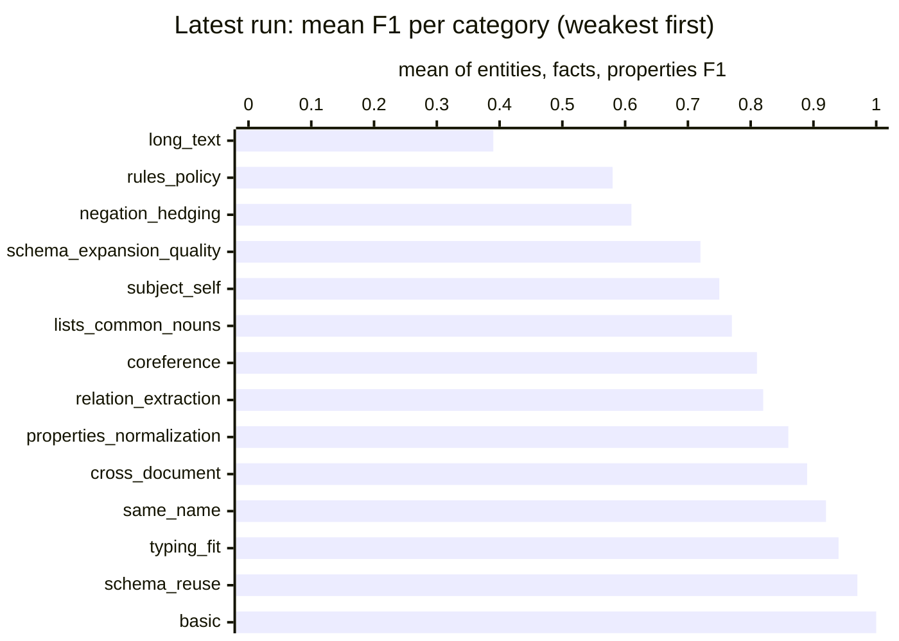

# Extraction benchmark results

Generated from `history.jsonl` — do not edit by hand.

Each full live run of the extraction benchmark (`python -m tests.benchmarks.extraction.run`, from
`lib/`) appends one summary line to `history.jsonl` and regenerates this page; commit both to
record the run. Partial runs (`--case`, `--mode`) are not recorded. The detailed per-stage report
of a run stays in `.reports/` (gitignored). To record a past run or re-render this page:
`python -m tests.benchmarks.extraction.history add <scores.json> [--note ...]` and
`python -m tests.benchmarks.extraction.history render`.

## Latest run

`20261010-173226` · commit `d4c49d1` · gpt-4o · 42 cases, 46 runs · judge gpt-4o-mini · *first 42-case run; dom/rng failures overcounted (check was not subclass-aware yet)*

| | entities F1 | facts F1 | props F1 | runs failing a check |
|---|---|---|---|---|
| **all** | 0.94 | 0.82 | 0.67 | 11 |

Each cell: latest value, ▲/▼ change since the previous run, and the history as a sparkline (`▁` = 0, `█` = 1).

## Trend

```mermaid
%%{init: {"themeVariables": {"xyChart": {"plotColorPalette": "#2563eb, #16a34a, #dc2626"}}}}%%
xychart-beta
    title "Mean F1 per run"
    x-axis ["261010-1732"]
    y-axis "F1" 0 --> 1
    line [0.94]
    line [0.82]
    line [0.67]
```

*Lines: blue = entities, green = facts, red = properties.*

## By category



| category | runs | entities F1 | facts F1 | props F1 | failing a check |
|---|---|---|---|---|---|
| basic | 1 | 1.00 | 1.00 | 1.00 | 0 |
| coreference | 3 | 0.92 | 0.84 | 0.67 | 1 |
| cross_document | 3 | 0.89 | 1.00 | 0.78 | 0 |
| lists_common_nouns | 3 | 0.87 | 0.76 | 0.67 | 0 |
| long_text | 2 | 0.75 | 0.41 | 0.00 | 1 |
| negation_hedging | 3 | 1.00 | 0.50 | 0.33 | 1 |
| properties_normalization | 4 | 1.00 | 0.67 | 0.92 | 2 |
| relation_extraction | 5 | 0.97 | 0.92 | 0.56 | 0 |
| rules_policy | 2 | 0.83 | 0.90 | 0.00 | 0 |
| same_name | 2 | 1.00 | 0.76 | 1.00 | 0 |
| schema_expansion_quality | 4 | 0.86 | 0.75 | 0.54 | 0 |
| schema_reuse | 7 | 0.97 | 0.95 | 1.00 | 4 |
| subject_self | 3 | 0.96 | 0.95 | 0.33 | 1 |
| typing_fit | 4 | 0.95 | 0.87 | 1.00 | 1 |

## By case (latest run)

<details><summary>Show all cases</summary>

| case · model · dedup | category | entities F1 | facts F1 | props F1 | failed checks |
|---|---|---|---|---|---|
| basic_extraction · gpt-4o · search | basic | 1.00 | 1.00 | 1.00 | — |
| coreference_epithets_company · gpt-4o · search | coreference | 0.75 | 0.86 | 1.00 | dom/rng |
| coreference_pronoun_and_epithet · gpt-4o · search | coreference | 1.00 | 1.00 | 0.00 | — |
| coreference_two_people · gpt-4o · search | coreference | 1.00 | 0.67 | 1.00 | — |
| cross_document_alias · gpt-4o · search | cross_document | 0.67 | 1.00 | 1.00 | — |
| cross_document_entity_fusion · gpt-4o · search | cross_document | 1.00 | 1.00 | 0.67 | — |
| cross_document_update · gpt-4o · search | cross_document | 1.00 | 1.00 | 0.67 | — |
| common_noun_entity_classes · gpt-4o · search | lists_common_nouns | 0.96 | 0.86 | 1.00 | — |
| lists_recipe_ingredients · gpt-4o · search | lists_common_nouns | 0.67 | 0.93 | 0.00 | — |
| lists_tech_stack · gpt-4o · search | lists_common_nouns | 1.00 | 0.50 | 1.00 | — |
| long_company_history · gpt-4o · search | long_text | 0.84 | 0.82 | 0.00 | dom/rng |
| long_meeting_notes · gpt-4o · search | long_text | 0.67 | 0.00 | 0.00 | — |
| negation_false_positive_trap · gpt-4o · search | negation_hedging | 1.00 | 0.00 | 0.00 | — |
| negation_former_and_absent · gpt-4o · search | negation_hedging | 1.00 | 1.00 | 1.00 | — |
| negation_hypothetical_plans · gpt-4o · search | negation_hedging | 1.00 | 0.50 | 0.00 | dom/rng |
| attribute_extraction_dense · gpt-4o · search | properties_normalization | 1.00 | 0.67 | 0.67 | schema |
| multi_valued_attributes · gpt-4o · search | properties_normalization | 1.00 | 1.00 | 1.00 | — |
| values_dates_formats · gpt-4o · search | properties_normalization | 1.00 | 1.00 | 1.00 | — |
| values_money_percent_units · gpt-4o · search | properties_normalization | 1.00 | 0.00 | 1.00 | norm |
| multi_fact_dense · gpt-4o · search | relation_extraction | 1.00 | 0.80 | 0.80 | — |
| relation_direction_acquisition · gpt-4o · search | relation_extraction | 1.00 | 1.00 | 1.00 | — |
| relation_extraction_multi_type · gpt-4o · search | relation_extraction | 1.00 | 1.00 | 1.00 | — |
| relation_study_vs_work · gpt-4o · search | relation_extraction | 1.00 | 1.00 | 0.00 | — |
| relation_symmetric_and_implicit · gpt-4o · search | relation_extraction | 0.86 | 0.80 | 0.00 | — |
| policy_leave_rules · gpt-4o · search | rules_policy | 1.00 | 1.00 | 0.00 | — |
| policy_requirement_not_instances · gpt-4o · search | rules_policy | 0.67 | 0.80 | 0.00 | — |
| same_name_apple · gpt-4o · search | same_name | 1.00 | 0.86 | 1.00 | — |
| same_name_jordan · gpt-4o · search | same_name | 1.00 | 0.67 | 1.00 | — |
| expansion_covers_text · gpt-4o · search | schema_expansion_quality | 0.77 | 0.00 | 1.00 | — |
| expansion_no_instance_classes · gpt-4o · search | schema_expansion_quality | 1.00 | 1.00 | 0.00 | — |
| expansion_property_placement · gpt-4o · search | schema_expansion_quality | 0.86 | 1.00 | 0.50 | — |
| schema_expansion_new_property · gpt-4o · search | schema_expansion_quality | 0.80 | 1.00 | 0.67 | — |
| reuse_class_synonym · gpt-4o · llm | schema_reuse | 1.00 | 1.00 | 1.00 | schema, dom/rng |
| reuse_class_synonym · gpt-4o · search | schema_reuse | 1.00 | 1.00 | 1.00 | — |
| reuse_relation_synonym · gpt-4o · llm | schema_reuse | 0.80 | 0.67 | 1.00 | — |
| reuse_relation_synonym · gpt-4o · search | schema_reuse | 1.00 | 1.00 | 1.00 | schema |
| schema_reuse_synonym · gpt-4o · llm | schema_reuse | 1.00 | 1.00 | 1.00 | schema |
| schema_reuse_synonym · gpt-4o · none | schema_reuse | 1.00 | 1.00 | 1.00 | schema |
| schema_reuse_synonym · gpt-4o · search | schema_reuse | 1.00 | 1.00 | 1.00 | — |
| subject_profile_third_person · gpt-4o · search | subject_self | 1.00 | 1.00 | 1.00 | dom/rng |
| subject_resume_lines · gpt-4o · search | subject_self | 0.89 | 0.86 | 0.00 | — |
| subject_user_preamble · gpt-4o · search | subject_self | 1.00 | 1.00 | 0.00 | — |
| entity_typing_subclass · gpt-4o · search | typing_fit | 1.00 | 1.00 | 1.00 | dom/rng |
| fit_agency_not_company · gpt-4o · search | typing_fit | 0.80 | 0.67 | 1.00 | — |
| fit_titles_not_entities · gpt-4o · search | typing_fit | 1.00 | 0.80 | 1.00 | — |
| fit_university_not_company · gpt-4o · search | typing_fit | 1.00 | 1.00 | 1.00 | — |

</details>

## All runs

| run | commit | models | cases | runs | entities | facts | props | failing a check | tokens | note |
|---|---|---|---|---|---|---|---|---|---|---|
| 20261010-173226 | `d4c49d1` | gpt-4o | 42 | 46 | 0.94 | 0.82 | 0.67 | 11 | 2.3M | first 42-case run; dom/rng failures overcounted (check was not subclass-aware yet) |

`*` = run made with uncommitted changes.
