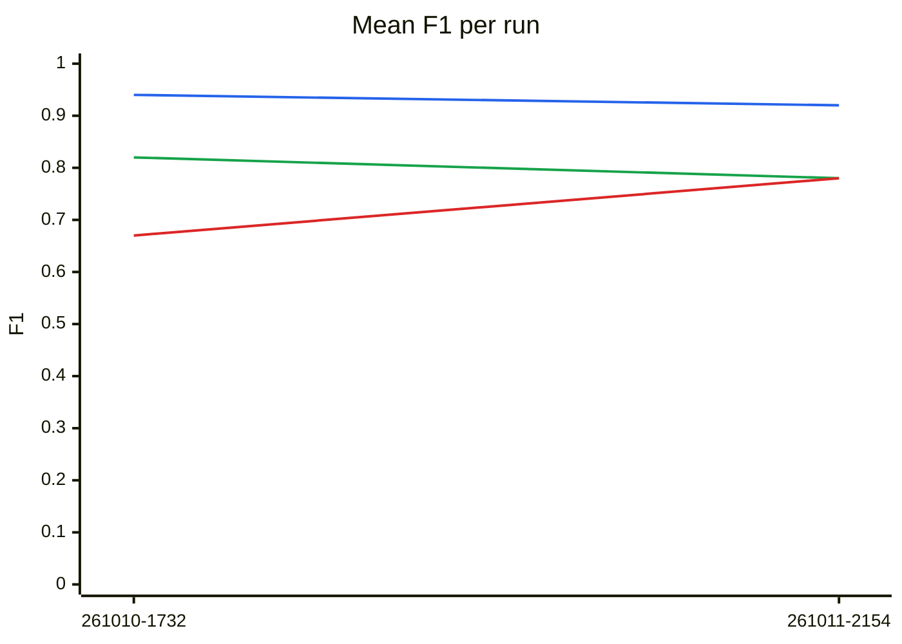
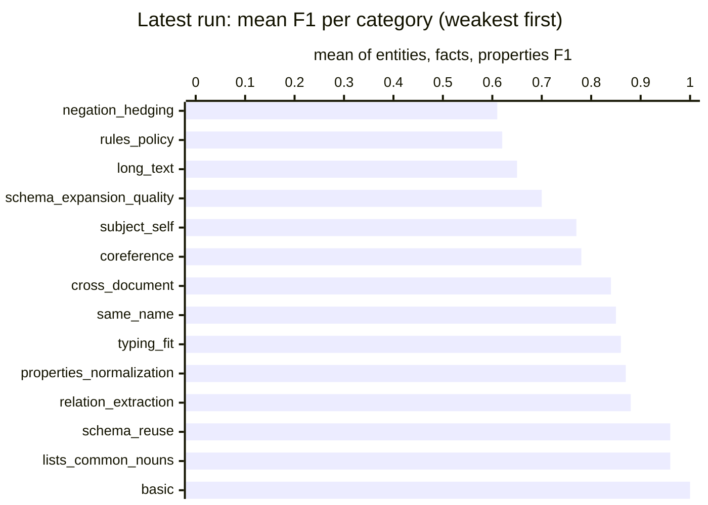

# Extraction benchmark results

Generated from `history.jsonl` — do not edit by hand.

Each full live run of the extraction benchmark (`python -m tests.benchmarks.extraction.run`, from
`lib/`) appends one summary line to `history.jsonl` and regenerates this page; commit both to
record the run. Partial runs (`--case`, `--mode`) are not recorded. The detailed per-stage report
of a run stays in `.reports/` (gitignored). To record a past run or re-render this page:
`python -m tests.benchmarks.extraction.history add <scores.json> [--note ...]` and
`python -m tests.benchmarks.extraction.history render`.

## Latest run

`20261011-215455` · commit `fb3438d` · gpt-4o · 43 cases, 47 runs · judge gpt-4o-mini · *after P0/P1 fixes: #128 span required, #95 typed properties, #96 id typos, #139*

| | entities F1 | facts F1 | props F1 | runs failing a check |
|---|---|---|---|---|
| **all** | 0.92 ▼0.01 `██` | 0.78 ▼0.04 `▇▇` | 0.78 ▲0.10 `▆▇` | 5 |

Each cell: latest value, ▲/▼ change since the previous run, and the history as a sparkline (`▁` = 0, `█` = 1).

## Trend

*Lines: blue = entities, green = facts, red = properties.*

## By category

| category | runs | entities F1 | facts F1 | props F1 | failing a check |
|---|---|---|---|---|---|
| basic | 1 | 1.00 `██` | 1.00 `██` | 1.00 `██` | 0 |
| coreference | 3 | 0.93 ▲0.01 `██` | 0.75 ▼0.09 `▇▇` | 0.67 `▆▆` | 0 |
| cross_document | 3 | 0.75 ▼0.14 `█▆` | 0.89 ▼0.11 `██` | 0.89 ▲0.11 `▇█` | 0 |
| lists_common_nouns | 3 | 0.97 ▲0.09 `▇█` | 0.93 ▲0.16 `▇█` | 1.00 ▲0.33 `▆█` | 0 |
| long_text | 2 | 0.81 ▲0.06 `▇▇` | 0.64 ▲0.23 `▄▆` | 0.50 ▲0.50 `▁▅` | 0 |
| negation_hedging | 3 | 1.00 `██` | 0.50 `▅▅` | 0.33 `▃▃` | 0 |
| properties_normalization | 5 | 0.82 ▼0.18 `█▇` | 0.80 ▲0.13 `▆▇` | 1.00 ▲0.08 `██` | 1 |
| relation_extraction | 5 | 0.97 `██` | 0.93 ▲0.01 `██` | 0.73 ▲0.17 `▅▆` | 0 |
| rules_policy | 2 | 1.00 ▲0.17 `▇█` | 0.53 ▼0.37 `█▅` | 0.33 ▲0.33 `▁▃` | 0 |
| same_name | 2 | 0.88 ▼0.12 `██` | 0.68 ▼0.08 `▇▆` | 1.00 `██` | 0 |
| schema_expansion_quality | 4 | 0.89 ▲0.04 `▇█` | 0.58 ▼0.17 `▇▅` | 0.62 ▲0.07 `▅▅` | 0 |
| schema_reuse | 7 | 0.97 `██` | 0.91 ▼0.05 `██` | 1.00 `██` | 4 |
| subject_self | 3 | 0.97 ▲0.01 `██` | 1.00 ▲0.05 `██` | 0.33 `▃▃` | 0 |
| typing_fit | 4 | 0.95 `██` | 0.62 ▼0.25 `▇▅` | 1.00 `██` | 0 |

## By case (latest run)

Show all cases

| case · model · dedup | category | entities F1 | facts F1 | props F1 | failed checks |
|---|---|---|---|---|---|
| basic_extraction · gpt-4o · search | basic | 1.00 `██` | 1.00 `██` | 1.00 `██` | — |
| coreference_epithets_company · gpt-4o · search | coreference | 0.89 ▲0.14 `▇█` | 0.40 ▼0.46 `▇▄` | 1.00 `██` | — |
| coreference_pronoun_and_epithet · gpt-4o · search | coreference | 1.00 `██` | 1.00 `██` | 0.00 `▁▁` | — |
| coreference_two_people · gpt-4o · search | coreference | 0.89 ▼0.11 `██` | 0.86 ▲0.19 `▆▇` | 1.00 `██` | — |
| cross_document_alias · gpt-4o · search | cross_document | 0.57 ▼0.10 `▆▅` | 1.00 `██` | 1.00 `██` | — |
| cross_document_entity_fusion · gpt-4o · search | cross_document | 0.67 ▼0.33 `█▆` | 0.67 ▼0.33 `█▆` | 1.00 ▲0.33 `▆█` | — |
| cross_document_update · gpt-4o · search | cross_document | 1.00 `██` | 1.00 `██` | 0.67 `▆▆` | — |
| common_noun_entity_classes · gpt-4o · search | lists_common_nouns | 0.90 ▼0.06 `██` | 0.78 ▼0.08 `▇▇` | 1.00 `██` | — |
| lists_recipe_ingredients · gpt-4o · search | lists_common_nouns | 1.00 ▲0.33 `▆█` | 1.00 ▲0.07 `██` | 1.00 ▲1.00 `▁█` | — |
| lists_tech_stack · gpt-4o · search | lists_common_nouns | 1.00 `██` | 1.00 ▲0.50 `▅█` | 1.00 `██` | — |
| long_company_history · gpt-4o · search | long_text | 0.82 ▼0.02 `▇▇` | 0.71 ▼0.12 `▇▆` | 0.00 `▁▁` | — |
| long_meeting_notes · gpt-4o · search | long_text | 0.80 ▲0.13 `▆▇` | 0.57 ▲0.57 `▁▅` | 1.00 ▲1.00 `▁█` | — |
| negation_false_positive_trap · gpt-4o · search | negation_hedging | 1.00 `██` | 0.00 `▁▁` | 0.00 `▁▁` | — |
| negation_former_and_absent · gpt-4o · search | negation_hedging | 1.00 `██` | 1.00 `██` | 1.00 `██` | — |
| negation_hypothetical_plans · gpt-4o · search | negation_hedging | 1.00 `██` | 0.50 `▅▅` | 0.00 `▁▁` | — |
| attribute_extraction_dense · gpt-4o · search | properties_normalization | 0.60 ▼0.40 `█▅` | 1.00 ▲0.33 `▆█` | 1.00 ▲0.33 `▆█` | — |
| fit_value_to_property · gpt-4o · search | properties_normalization | 1.00 | 1.00 | 1.00 | — |
| multi_valued_attributes · gpt-4o · search | properties_normalization | 0.50 ▼0.50 `█▅` | 1.00 `██` | 1.00 `██` | — |
| values_dates_formats · gpt-4o · search | properties_normalization | 1.00 `██` | 1.00 `██` | 1.00 `██` | — |
| values_money_percent_units · gpt-4o · search | properties_normalization | 1.00 `██` | 0.00 `▁▁` | 1.00 `██` | norm |
| multi_fact_dense · gpt-4o · search | relation_extraction | 1.00 `██` | 1.00 ▲0.20 `▇█` | 1.00 ▲0.20 `▇█` | — |
| relation_direction_acquisition · gpt-4o · search | relation_extraction | 1.00 `██` | 1.00 `██` | 1.00 `██` | — |
| relation_extraction_multi_type · gpt-4o · search | relation_extraction | 1.00 `██` | 1.00 `██` | 1.00 `██` | — |
| relation_study_vs_work · gpt-4o · search | relation_extraction | 1.00 `██` | 0.86 ▼0.14 `█▇` | 0.67 ▲0.67 `▁▆` | — |
| relation_symmetric_and_implicit · gpt-4o · search | relation_extraction | 0.86 `▇▇` | 0.80 `▇▇` | 0.00 `▁▁` | — |
| policy_leave_rules · gpt-4o · search | rules_policy | 1.00 `██` | 0.67 ▼0.33 `█▆` | 0.67 ▲0.67 `▁▆` | — |
| policy_requirement_not_instances · gpt-4o · search | rules_policy | 1.00 ▲0.33 `▆█` | 0.40 ▼0.40 `▇▄` | 0.00 `▁▁` | — |
| same_name_apple · gpt-4o · search | same_name | 0.75 ▼0.25 `█▇` | 0.86 `▇▇` | 1.00 `██` | — |
| same_name_jordan · gpt-4o · search | same_name | 1.00 `██` | 0.50 ▼0.17 `▆▅` | 1.00 `██` | — |
| expansion_covers_text · gpt-4o · search | schema_expansion_quality | 0.91 ▲0.14 `▇█` | 0.00 `▁▁` | 1.00 `██` | — |
| expansion_no_instance_classes · gpt-4o · search | schema_expansion_quality | 1.00 `██` | 0.67 ▼0.33 `█▆` | 0.00 `▁▁` | — |
| expansion_property_placement · gpt-4o · search | schema_expansion_quality | 1.00 ▲0.14 `▇█` | 1.00 `██` | 0.80 ▲0.30 `▅▇` | — |
| schema_expansion_new_property · gpt-4o · search | schema_expansion_quality | 0.67 ▼0.13 `▇▆` | 0.67 ▼0.33 `█▆` | 0.67 `▆▆` | — |
| reuse_class_synonym · gpt-4o · llm | schema_reuse | 1.00 `██` | 1.00 `██` | 1.00 `██` | schema |
| reuse_class_synonym · gpt-4o · search | schema_reuse | 1.00 `██` | 0.67 ▼0.33 `█▆` | 1.00 `██` | — |
| reuse_relation_synonym · gpt-4o · llm | schema_reuse | 1.00 ▲0.20 `▇█` | 0.67 `▆▆` | 1.00 `██` | — |
| reuse_relation_synonym · gpt-4o · search | schema_reuse | 0.80 ▼0.20 `█▇` | 1.00 `██` | 1.00 `██` | schema |
| schema_reuse_synonym · gpt-4o · llm | schema_reuse | 1.00 `██` | 1.00 `██` | 1.00 `██` | schema |
| schema_reuse_synonym · gpt-4o · none | schema_reuse | 1.00 `██` | 1.00 `██` | 1.00 `██` | schema |
| schema_reuse_synonym · gpt-4o · search | schema_reuse | 1.00 `██` | 1.00 `██` | 1.00 `██` | — |
| subject_profile_third_person · gpt-4o · search | subject_self | 1.00 `██` | 1.00 `██` | 1.00 `██` | — |
| subject_resume_lines · gpt-4o · search | subject_self | 0.91 ▲0.02 `██` | 1.00 ▲0.14 `▇█` | 0.00 `▁▁` | — |
| subject_user_preamble · gpt-4o · search | subject_self | 1.00 `██` | 1.00 `██` | 0.00 `▁▁` | — |
| entity_typing_subclass · gpt-4o · search | typing_fit | 1.00 `██` | 0.00 ▼1.00 `█▁` | 1.00 `██` | — |
| fit_agency_not_company · gpt-4o · search | typing_fit | 0.80 `▇▇` | 0.67 `▆▆` | 1.00 `██` | — |
| fit_titles_not_entities · gpt-4o · search | typing_fit | 1.00 `██` | 0.80 `▇▇` | 1.00 `██` | — |
| fit_university_not_company · gpt-4o · search | typing_fit | 1.00 `██` | 1.00 `██` | 1.00 `██` | — |

## All runs

| run | commit | models | cases | runs | entities | facts | props | failing a check | tokens | note |
|---|---|---|---|---|---|---|---|---|---|---|
| 20261011-215455 | `fb3438d` | gpt-4o | 43 | 47 | 0.92 | 0.78 | 0.78 | 5 | 2.6M | after P0/P1 fixes: #128 span required, #95 typed properties, #96 id typos, #139 |
| 20261010-173226 | `d4c49d1` | gpt-4o | 42 | 46 | 0.94 | 0.82 | 0.67 | 11 | 2.3M | first 42-case run; dom/rng failures overcounted (check was not subclass-aware yet) |

`*` = run made with uncommitted changes.
