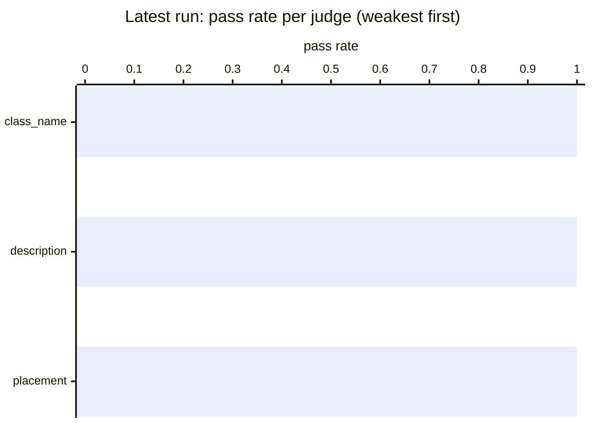

# Judge benchmark results

Generated from `history.jsonl` — do not edit by hand.

Each full live run of the judge benchmark (`python -m tests.benchmarks.judges.run`, from `lib/`)
appends one summary line to `history.jsonl` and regenerates this page; commit both to record the
run. Partial runs (`--case`) are not recorded. To record a past run or re-render this page:
`python -m tests.benchmarks.judges.history add <scores.json> [--note ...]` and
`python -m tests.benchmarks.judges.history render`.

Checks are deterministic. `placement` and `class_name` have exact gold answers. `description` has
guards only (not empty, 3 words or more, 300 characters or fewer), so its pass rate says nothing
about quality: a person reads those in the run's table.

## Latest run

`20261109-182813` · commit `24ffe22` · gpt-4o · 18 runs · *after #183-#184, #187, #189 and the partial #190 fix, on blue-data 78e57b3*

| | pass rate | runs with an issue |
|---|---|---|
| **all** | 1.00 `██` | 0 |

Each cell: latest value, ▲/▼ change since the previous run, and the history as a sparkline (`▁` = 0, `█` = 1).

## Trend

```mermaid
%%{init: {"themeVariables": {"xyChart": {"plotColorPalette": "#2563eb"}}}}%%
xychart-beta
    title "Mean score per run"
    x-axis ["261105-1615", "261109-1828"]
    y-axis "score" 0 --> 1
    line [1.00, 1.00]
```

*Lines: blue = pass rate.*

## By judge



| judge | runs | pass rate | with an issue |
|---|---|---|---|
| class_name | 10 | 1.00 `██` | 0 |
| description | 3 | 1.00 `██` | 0 |
| placement | 5 | 1.00 `██` | 0 |

## By case (latest run)

<details><summary>Show all cases</summary>

| case | judge | pass rate | issues |
|---|---|---|---|
| apple_is_not_fruit · gpt-4o | class_name | 1.00 `██` | — |
| board_of_directors_convention · gpt-4o | class_name | 1.00 `██` | — |
| corporation_reuses_company · gpt-4o | class_name | 1.00 `██` | — |
| firm_reuses_company · gpt-4o | class_name | 1.00 `██` | — |
| lowercase_variant_reuses · gpt-4o | class_name | 1.00 `██` | — |
| ministry_is_not_company · gpt-4o | class_name | 1.00 `██` | — |
| person_reuse · gpt-4o | class_name | 1.00 `██` | — |
| physician_reuses_doctor · gpt-4o | class_name | 1.00 `██` | — |
| plural_reuses_employee · gpt-4o | class_name | 1.00 `██` | — |
| spaceship_is_new · gpt-4o | class_name | 1.00 `██` | — |
| describe_company_class · gpt-4o | description | 1.00 `██` | — |
| describe_term_property · gpt-4o | description | 1.00 `██` | — |
| describe_worked_at_relation · gpt-4o | description | 1.00 `██` | — |
| multi_role_start_date · gpt-4o | placement | 1.00 `██` | — |
| name_on_person · gpt-4o | placement | 1.00 `██` | — |
| salary_on_employee · gpt-4o | placement | 1.00 `██` | — |
| tail_number_distractor · gpt-4o | placement | 1.00 `██` | — |
| wingspan_on_aircraft · gpt-4o | placement | 1.00 `██` | — |

</details>

## All runs

| run | commit | models | runs | pass rate | with an issue | tokens | note |
|---|---|---|---|---|---|---|---|---|
| 20261109-182813 | `24ffe22` | gpt-4o | 18 | 1.00 | 0 | — | after #183-#184, #187, #189 and the partial #190 fix, on blue-data 78e57b3 |
| 20261105-161555 | `c36e6e3` | gpt-4o | 18 | 1.00 | 0 | — | first recorded run; after the 1.0 release fixes (#173-#182), on blue-data 78e57b3 |

`*` = run made with uncommitted changes.
