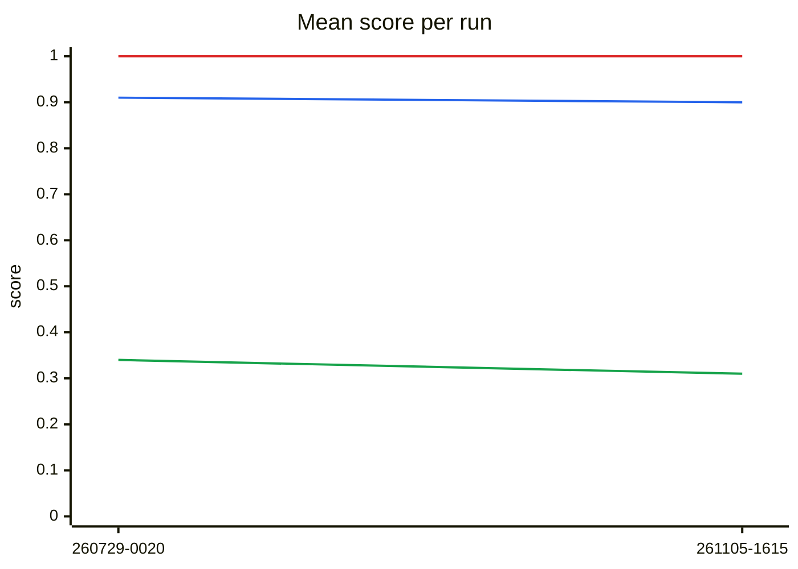
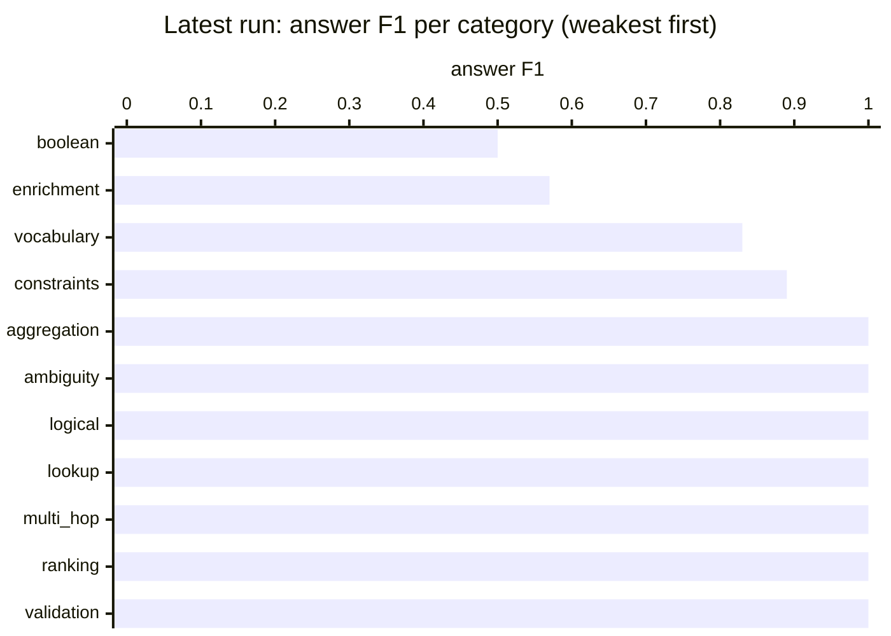

# Querying benchmark results

Generated from `history.jsonl` — do not edit by hand.

Each full live run of the querying benchmark (`python -m tests.benchmarks.querying.run`, from
`lib/`) appends one summary line to `history.jsonl` and regenerates this page; commit both to
record the run. Partial runs (`--case`, `--search-mode`) are not recorded. To record a past run or
re-render this page: `python -m tests.benchmarks.querying.history add <scores.json> [--note ...]`
and `python -m tests.benchmarks.querying.history render`.

**Answer F1** is the F1 of `answer`'s and `enrich`'s rows against the gold rows, and for `validate`
the mean of the supporting and counter facts' F1. **Column-name F1** is the overlap of `answer`'s
column names with the gold ones. **NL faithful** is the share of natural-language answers that an
LLM judge found true to the gold facts, on the few cases that test them.

## Latest run

`20261105-161556` · commit `c36e6e3` · gpt-4o · 21 runs · judge gpt-4o-mini · *after the 1.0 release fixes (#173-#182), on blue-data 78e57b3*

| | answer F1 | column-name F1 | NL faithful | runs with an issue |
|---|---|---|---|---|
| **all** | 0.90 ▼0.01 `██` | 0.31 ▼0.03 `▃▃` | 1.00 `██` | 0 |

Each cell: latest value, ▲/▼ change since the previous run, and the history as a sparkline (`▁` = 0, `█` = 1).

## Trend

*Lines: blue = answer F1, green = column-name F1, red = NL faithful.*

## By category

| category | runs | answer F1 | column-name F1 | NL faithful | with an issue |
|---|---|---|---|---|---|
| aggregation | 2 | 1.00 `██` | 0.00 `▁▁` | — | 0 |
| ambiguity | 1 | 1.00 `██` | 0.00 ▼0.33 `▃▁` | — | 0 |
| boolean | 2 | 0.50 `▅▅` | 0.50 `▅▅` | — | 0 |
| constraints | 3 | 0.89 ▼0.11 `██` | 0.21 ▼0.13 `▃▂` | — | 0 |
| enrichment | 1 | 0.57 ▼0.43 `█▅` | — | — | 0 |
| logical | 2 | 1.00 `██` | 0.20 ▲0.03 `▂▂` | — | 0 |
| lookup | 3 | 1.00 `██` | 0.60 `▅▅` | 1.00 `██` | 0 |
| multi_hop | 2 | 1.00 ▲0.17 `▇█` | 0.20 ▲0.03 `▂▂` | — | 0 |
| ranking | 2 | 1.00 `██` | 0.40 `▄▄` | — | 0 |
| validation | 1 | 1.00 ▲0.50 `▅█` | — | 1.00 `██` | 0 |
| vocabulary | 2 | 0.83 ▼0.17 `█▇` | 0.45 ▲0.05 `▄▄` | — | 0 |

## By case (latest run)

Show all cases

| case | category | answer F1 | column-name F1 | NL faithful | issues |
|---|---|---|---|---|---|
| answer_aggregation_avg_order_value · gpt-4o · keyword | aggregation | 1.00 `██` | 0.00 `▁▁` | — | — |
| answer_aggregation_count_loans · gpt-4o · keyword | aggregation | 1.00 `██` | 0.00 `▁▁` | — | — |
| answer_ambiguous_entity_reference · gpt-4o · keyword | ambiguity | 1.00 `██` | 0.00 ▼0.33 `▃▁` | — | — |
| answer_boolean_did_alice_work_at_ibm · gpt-4o · keyword | boolean | 1.00 `██` | 0.00 `▁▁` | — | — |
| answer_boolean_is_party_to_agreement · gpt-4o · keyword | boolean | 0.00 `▁▁` | 1.00 `██` | — | — |
| answer_constraint_categorical_diagnosis · gpt-4o · keyword | constraints | 1.00 `██` | 0.33 `▃▃` | — | — |
| answer_constraint_numeric_loan_amount · gpt-4o · keyword | constraints | 0.67 ▼0.33 `█▆` | 0.00 ▼0.33 `▃▁` | — | — |
| answer_constraint_temporal_hire_date · gpt-4o · keyword | constraints | 1.00 `██` | 0.29 ▼0.05 `▃▃` | — | — |
| enrich_multi_hop · gpt-4o · keyword | enrichment | 0.57 ▼0.43 `█▅` | — | — | — |
| answer_logical_and_not_worked_at · gpt-4o · keyword | logical | 1.00 `██` | 0.00 `▁▁` | — | — |
| answer_logical_or_conditions · gpt-4o · keyword | logical | 1.00 `██` | 0.40 ▲0.07 `▃▄` | — | — |
| answer_employment_history · gpt-4o · keyword | lookup | 1.00 `██` | 0.57 `▅▅` | — | — |
| answer_employment_history · gpt-4o · semantic | lookup | 1.00 `██` | 0.57 `▅▅` | — | — |
| answer_property_lookup · gpt-4o · keyword | lookup | 1.00 `██` | 0.67 `▆▆` | 1.00 `██` | — |
| answer_multihop_manager_reports · gpt-4o · keyword | multi_hop | 1.00 `██` | 0.40 ▲0.07 `▃▄` | — | — |
| answer_multihop_parent_company_affiliates · gpt-4o · keyword | multi_hop | 1.00 ▲0.33 `▆█` | 0.00 `▁▁` | — | — |
| answer_ranking_highest_paid · gpt-4o · keyword | ranking | 1.00 `██` | 0.40 `▄▄` | — | — |
| answer_ranking_top_suppliers · gpt-4o · keyword | ranking | 1.00 `██` | 0.40 `▄▄` | — | — |
| validate_supporting_and_counter · gpt-4o · keyword | validation | 1.00 ▲0.50 `▅█` | — | 1.00 `██` | — |
| answer_vocabulary_premium_customer · gpt-4o · keyword | vocabulary | 0.67 ▼0.33 `█▆` | 0.50 ▲0.10 `▄▅` | — | — |
| answer_vocabulary_top_seller_product · gpt-4o · keyword | vocabulary | 1.00 `██` | 0.40 `▄▄` | — | — |

## All runs

| run | commit | models | runs | answer F1 | column-name F1 | NL faithful | with an issue | tokens | note |
|---|---|---|---|---|---|---|---|---|---|---|
| 20261105-161556 | `c36e6e3` | gpt-4o | 21 | 0.90 | 0.31 | 1.00 | 0 | 166K | after the 1.0 release fixes (#173-#182), on blue-data 78e57b3 |
| 20260729-002012 | `a104edc` | gpt-4o | 21 | 0.91 | 0.34 | 1.00 | 0 | 132K | first full run; recovered from .reports, same cases and row scoring as today |

`*` = run made with uncommitted changes.
